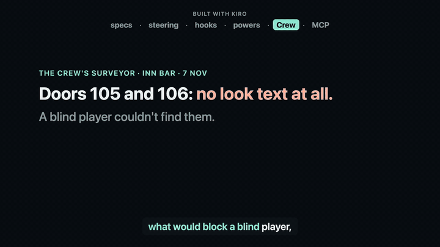

<div align="center">

# 👻 Ghostlight Survey Crew

**A Kiro Crew that plays old point-and-click adventures through their real game engine at night,<br>and tells you everything a blind player couldn't get past by morning.**

_Companion to [Ghostlight](https://github.com/thekashifnazir/ghostlight) · Kiroween 2026 · Best Kiro Crew App entry_


[**Play Ghostlight**](https://ghostlight.kashifnazir.com) · [**Ghostlight repo**](https://github.com/thekashifnazir/ghostlight) · [**Reports**](reports/) · [**The crew**](#2-the-crew) · [**What it found**](#3-what-it-found)

</div>

<p align="center">
  <a href="https://youtu.be/gfpjhE8Vopw"></a>
  <br>
  <sub>▶ Silent preview. <a href="https://youtu.be/gfpjhE8Vopw"><b>Watch the full video with sound</b></a></sub>
</p>

> **In 30 seconds.** [Ghostlight](https://ghostlight.kashifnazir.com) makes *Drascula: The Vampire Strikes Back* (1996, freeware) playable with a screen reader in the browser. That needs a description pack: a name, a description and an exit label for everything in every room, plus hints that match how far you've got. Writing that by hand is slow, and checking that every puzzle can be done without sight is slower. This crew does the mechanical part overnight. It plays the real engine through an MCP server, looks at every hotspot, flags anything a blind player would miss, drafts pack entries for a human to approve in Discord, and replays the whole game from start to ending every morning. People spend their time on what only they can judge. Code and reports are AI-generated under my direction.

| **10** nights run | **10 of 11** whole-game runs pass | **6 of 6** chapters' hints walked | **10** rooms drafted overnight | **5** bugs found and fixed |
|:---:|:---:|:---:|:---:|:---:|
| 8 of 10 passed, 0 credits<br><sub>8 to 17 Nov; plus 4 rooms of a second game</sub> | start to final ending, 211-line route<br><sub>12 to 20 Nov; the one failure (18 Nov) was two commands refused, fixed in the MCP server, and the next run passed</sub> | 61 of 65 hints pass, 0 hint faults left<br><sub>17 Nov, after the chapter 3 fix; 84 of 102 exits confirmed, none wrong</sub> | chapter 4, for human review<br><sub>all 10 approved and in the pack</sub> | in the MCP server and the engine layer<br><sub>each fixed in Ghostlight</sub> |

<sub>Counted from <code>reports/</code>, <code>drafts/ch4/decisions.json</code> and the Ghostlight log on 17 Nov 2026; whole-game runs recounted 21 Nov.</sub>

## Contents

1. [Why it exists](#1-why-it-exists)
2. [The crew](#2-the-crew)
3. [What it found](#3-what-it-found)
4. [The night shift](#4-the-night-shift)
5. [Point it at a new game](#5-point-it-at-a-new-game)
6. [Safety by design](#6-safety-by-design)
7. [How it's wired](#7-how-its-wired)
8. [Honest limits](#8-honest-limits)

## 1. Why it exists

**Surveying 57 rooms by hand is days of work. The crew does the repeatable part overnight and leaves the judgement calls to people.**

<details>
<summary>More</summary>

<br>

An accessible old game needs a description pack. Ghostlight's pack covers all 57 of Drascula's rooms (15 Nov 2026). Every room was surveyed against the engine before it was described, so each description is written against what the engine actually says, not against memory of the game. The full sweep of chapters 2 to 6 was done by Claude Code agents driving the same MCP server; the crew drafts from those reports, re-checks rooms every night and surveyed the second game itself.

The split is deliberate. A machine can check whether the screen reader says the right thing, once, in order. Only blind players can say whether the game is fun and fair. Ghostlight's blind testers, including Chad Bouton, a blind accessibility consultant, spend their time on the second kind of question because the crew handles the first.

</details>

## 2. The crew

**Five jobs, each with one narrow task and the least access that does it.**

<details>
<summary>The bots and jobs</summary>

<br>

| Bot or job | What it does | What it may do |
|---|---|---|
| **surveyor** | Plays the game through the `drascula-live` MCP server (the real ScummVM engine), room by room, following the pack's milestones. Looks at every hotspot and reports puzzle blockers, missing descriptions, and engine or tooling bugs | The game tools run without asking. Fetching web pages, searching the web, changing its own model or approval mode, asking for more abilities and changing schedules all need a human yes. Writes only to `reports/` |
| **nightly** | A zero-token Crew command job: surveys three rooms (9, 3 and 5) and runs eight checks on the live site (start, the "worth a look" nudge, list, talk, choice, crossing, save and load, and the How to play guide). Writes a dated report | Runs one script |
| **night drafter** | A Crew agent job that drafts pack entries (room names, descriptions, exit labels) for the next undrafted rooms, in the pack's style, into `drafts/` | Writes its draft files only. Every shell command is denied |
| **review cards** | Posts one card per new room to a Discord thread: "Reply here with: Approve, Change or Reject". The decision is recorded in `drafts/ch4/decisions.json` | Nothing goes into the pack without a human Approve |
| **whole-game check** | A zero-token job that replays the full route (`data/playthrough-route.txt`) from a fresh start to the final ending and checks every chapter is reached | Runs one script |
| **hint walker** | A Crew agent job (claude-haiku-5.5) that plays one chapter by following only the pack's hint answers, in the real engine, and marks each hint PASS or FIX. It's given the names a player hears, not the engine's raw ones | The game tools and writes to `reports/` only. Runs on a human's go, one chapter at a time |
| **exit check** | A zero-token script that rides the whole-game route and, in each room, walks every exit and checks it lands where its label says | Runs one script |
| **listener** | After a deploy, runs one fixed script in a Windows VM: a browser plus NVDA, pressing the keys a player would, and compares what NVDA actually said with what it should have said | Trigger-only, run by hand. Runs that one script |

</details>

## 3. What it found

**Real bugs that blocked blind players, and traps a sighted tester would walk past.**

<details>
<summary>Bugs, fixed in Ghostlight</summary>

<br>

- **Couldn't open a carried item.** The MCP server rejected `open` on the handbag you carry, which blocked the rest of chapter 2 ([`reports/bug-open-held-item.md`](reports/bug-open-held-item.md)).
- **Carried items not tracked between moves**, **`state` returning stale flags**, and **`skip` with nothing to skip waiting 60 seconds**.
- **Chapter ends dropped.** In chapters 3, 4 and 5 the final action played its animation but the chapter never ended, because the accessibility layer ignored the engine's return value. Found by a Claude Code coverage run on 10 Nov, not by the crew ([`reports/ch4-coverage-2026-11-10.md`](reports/ch4-coverage-2026-11-10.md)), so it isn't in the count above. The crew's whole-game check now guards it every morning, reaching all six chapters and the ending.
- **A wrong hint answer in chapter 3.** The pilot hint walk on 16 Nov found that the vampire answer started with a door the player had already gone through. Ghostlight reworded it, and a second walk on 17 Nov passed from both rooms a player could ask in ([`reports/hint-walk-ch3-vampire.md`](reports/hint-walk-ch3-vampire.md)).
- **Second game, first run:** long lines in Flight of the Amazon Queen outlasted the MCP server's 10 second quiet limit, so commands were dropped as busy. Kiro fixed it the same day, and the rerun came back clean ([`reports/queen/`](reports/queen/)).

</details>

<details>
<summary>Things a blind player would miss</summary>

<br>

- **Silent hotspots:** looking gives nothing, or filler like "I can't see anything in particular". In the 10 Nov coverage sweep (Claude Code), chapter 4 alone had 82 hotspots, of which 27 objects and 39 exits said nothing useful; chapter 5 had 6 and 18 of 39; chapter 6 had 8 and 5 of 23. The night drafter's flags (below) come from the crew itself ([`drafts/ch4/flags.md`](drafts/ch4/flags.md)).
- **Fake doors:** something that looks like a door but isn't an exit, sitting right next to one that is.
- **Hidden hotspots:** objects the engine marks as not visible, so pointing would never find them.
- **Shared numbers:** two speakers or two tapestries with the same id, so looking always hits the first.
- **Every hint and every exit, followed in the engine (17 Nov).** The hint walker went through all six chapters: 61 of 65 hints passed and 2 more worked with wording notes that were kept. The last 2 are a walker mistake and a hint it never reached, and the whole-game route covers both. The exit check walked all 102 exits along the route: 84 land where the label says, none land anywhere else, and the rest are shut at that point, chapter crossings, or in rooms the route doesn't stand in ([`reports/hint-walk-ch1.md`](reports/hint-walk-ch1.md) to [`ch6`](reports/hint-walk-ch6.md), [`reports/exit-check-2026-11-17.md`](reports/exit-check-2026-11-17.md)).
- **A scripted trap in the second game:** looking at the truck in the hotel lobby walks the hero past two henchmen, who catch him and send him back to the locked room after about 46 seconds of dialogue. The pack now warns about it.

</details>

## 4. The night shift

**It ran on a schedule until 16 Nov: a cloud VM switched on at 01:00 and off at 11:00 London, about $19 a month. The schedule has since been switched off.**

<details>
<summary>A night, hour by hour</summary>

<br>

The schedule is a Compute Engine instance schedule (`crew-overnight`, start `0 1 * * *`, stop `0 11 * * *`, Europe/London). Kiro Crew runs on the VM as a systemd service. The cost is about $19 a month at the London prices read on 11 Nov 2026, against about $66 left on.

| Time (London) | Job | Kiro credits |
|---|---|---|
| 02:00 | nightly room survey plus the live-site check | none (a script job) |
| 03:00 | night drafter writes the next rooms' entries | about 1.9 on 12 Nov |
| about 06:30 | review cards posted to the Discord thread | about 1.1 on 12 Nov |
| 07:00 | whole-game check, start to final ending | none |
| morning | Approve, Change or Reject per room in Discord | none |

The two agent jobs (night drafter and review cards) were also paused on 17 Nov, because they fire whenever the VM is up and the drafter had started re-drafting rooms a human had already approved. The script jobs still run when it's on.

Results so far:

- **Nightly:** 10 runs, 8 to 17 Nov. 8 passed. The 9 Nov run failed because the engine didn't start, and on 15 Nov the rooms passed but the live-site check got stuck on the site's new start screen. It passed again on 16 and 17 Nov.
- **Whole-game:** 8 runs, 12 to 17 Nov, all passed, the last on the frozen build. Each reached chapters 1 to 6 and the ending in about 26 minutes, with 0 failed commands. On its first morning it failed 6 times before the run that started at 09:44 UTC passed; every fix was in the replay script, not the game (recounted from git 17 Nov: 55417c1 to e95d063 FAIL, 88b339d PASS).
- **Listener:** 3 runs. The first two, on 12 Nov, failed: one wrote no report, and one passed 16 of 16 tavern steps but 12 of 13 drunk steps. The 14 Nov run passed both, 16 of 16 and 13 of 13, and so did both 17 Nov runs, the second on the frozen build.

</details>

## 5. Point it at a new game

**The second game's surveyor is the same agent with a different game: one new file in `agents/`, no new code in this repo.**

<details>
<summary>What changed for Flight of the Amazon Queen</summary>

<br>

[`agents/queen-surveyor-agent.json`](agents/queen-surveyor-agent.json) is a copy of [`agents/surveyor-agent.json`](agents/surveyor-agent.json). The differences are the name, the MCP server name (`queen-live`), the report folder (`reports/queen/`), and the server's environment:

```json
"GHOSTLIGHT_GAME": "queen",
"DRASCULA_MCP_SAVEPATH": "./.saves/queen",
"GHOSTLIGHT_QUEEN_BINARY": "../spikes/queen/scummvm/scummvm",
"DRASCULA_MCP_GAME": "../spikes/queen/game/FOTAQ_Floppy",
"SDL_AUDIODRIVER": "dummy"
```

On 14 Nov it surveyed all 4 rooms of the hotel opening as two one-off Crew jobs (5.75 and 5.59 Kiro credits). Its first run found the quiet-limit bug, and its second found the truck trap. The game side needed real work in Ghostlight first (an accessibility layer for the Queen engine and Queen support in the MCP server); the crew side was the one file.

</details>

## 6. Safety by design

**Every bot gets the least it needs, and a human approves everything that reaches players.**

<details>
<summary>The rules</summary>

<br>

- **Narrow agent spec.** The surveyor's tools are one MCP server plus file reads. It writes only to `reports/`, and anything else falls back to deny. The spec is copied into `~/.kiro/agents/` by a human, so a bot can't change its own trust settings.
- **The drafter writes drafts only.** It can write its draft files and nothing else; every shell command is denied.
- **The GitHub token never enters the agent sandbox.** A user timer outside Crew pulls Ghostlight at 01:50 and pushes the night's reports in the morning, and Crew's sandbox hides the credentials from jobs. On 15 Nov a draft clash left that push stuck and two nights never reached GitHub, so the push script now clears a stuck rebase and sends a clash to a side branch for a person to merge ([`scripts/crew-push.sh`](scripts/crew-push.sh)).
- **Hint walks cost credits, so a person starts them.** [`scripts/hint-walk-changed.sh`](scripts/hint-walk-changed.sh) re-walks only the chapters whose hints changed since a given Ghostlight commit; `--dry-run` lists them without spending anything.
- **A human approves every pack entry** in Discord before it's merged. Approved rooms go into Ghostlight's pack through its survey pipeline, which keeps the file's layout stable and runs the validator and coverage check.

</details>

## 7. How it's wired

**Kiro Crew, one MCP server from the Ghostlight repo, and a native ScummVM build.**

<details>
<summary>Files</summary>

<br>

- `agents/`: the two surveyor specs, the hint walker spec and its prompts.
- `scripts/`: the nightly (`nightly-rooms.mjs`, `nightly-live.mjs`), the whole-game check (`whole-game.mjs`), the exit check (`exit-check.mjs`), the hint walks (`hint-walk-prompt.py`, `hint-walk-changed.sh`), the push (`crew-push.sh`), the listener (`listener.sh`, `listener-request.sh`, `listener_report.py`) and the VM setup (`vm-setup.sh`, `VM-SETUP.md`).
- `data/playthrough-route.txt`: the 211-line route the whole-game check replays.
- `drafts/`: night drafter output and the review decisions.
- `reports/`: every survey, nightly, whole-game and listener report, dated.
- The `drascula-live` MCP server comes from the Ghostlight repo (`mcp/`), run with the native ScummVM build and its own save folder (`.saves/`, not committed). Game data is never committed.

Paths inside `reports/` are from the machine that ran each report (a Mac or the Linux VM), so they won't match yours.

</details>

## 8. Honest limits

**It finds mechanical problems. It can't tell you whether a game is fun without sight.**

<details>
<summary>Details</summary>

<br>

- Automated checks don't replace blind players. Ghostlight's testers played it during the build, and one finished the whole game on 16 Nov.
- A Bot's spawned workers in Kiro Crew don't receive that Bot's own MCP servers, so the surveyor plays from its own session. Reported as feedback to the Crew team.
- On the Mac, `kirocrew chat --agent` didn't load a custom agent's MCP servers, so the second game's surveys ran as one-off cron jobs instead.
- The chapter 4, 5 and 6 surveys started from hand-built chapter-start saves, because the chapter ends were blocked at the time. The whole-game check has since played every chapter through from a fresh start.
- The hint walker reads the game through the engine, not the player, so it makes mistakes a player wouldn't. On 17 Nov its first chapter 6 run took "yourself" for "your hand" (both are HACKER in the engine) and gave up; it now gets the names a player hears. It also missed the close action once and tried a hint out of order once. Every FIX is checked against the whole-game route before anyone acts on it.
- Long hint walks cost more than short ones, and not in proportion: chapter 6 (11 actions) cost 0.27 Kiro credits and chapter 4 (45 actions) cost 3.41. The 17 Nov walks came to about 9.5 credits, counting one spoilt run and one re-check.
- Review is still a person reading every card. That's on purpose.

</details>

## Licence

GPL-3.0-or-later, the same as Ghostlight and ScummVM. See `LICENSE`.
